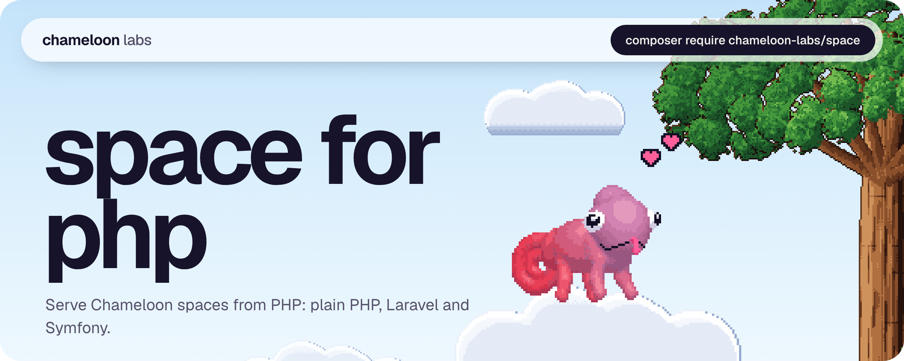
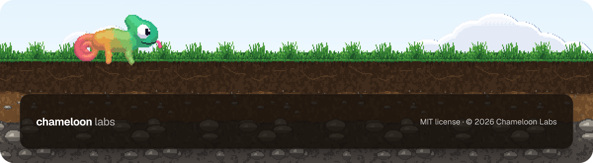

<a href="https://github.com/Chameloon-Labs/space-php"></a>

<p align="center">
  <a href="https://chameloon.com/docs/"></a>
  <a href="https://chameloon.com/docs/protocol/"></a>
</p>

Serve Chameloon spaces from PHP: a folder of spaces, sync with the app, bots in plain PHP. It passes the Chameloon server [conformance suite](https://github.com/Chameloon-Labs/conformance).

## Install

```sh
composer require chameloon-labs/space
```

It needs PHP 8.1 or newer with `ext-openssl` and `ext-json`. It has no other dependencies.

PHP runs one process per request, so all state lives in files next to each space and is guarded with `flock`: `server-data.json` (rows and cursors), `auth.json` (invites and phones) and `.chameloon-replay.json` (signatures seen in the last 10 minutes). None of them is ever served. The files have the same shape as in the TypeScript server, so a space can move between servers.

## Quick start

A server serves a folder with one sub-folder per space. A sub-folder is a space when it has a `space.json`:

```
spaces/
  todo/
    space.json
    pages/home.oui
    img/logo.png
    bot.php          optional
```

Write a router, `router.php`:

```php
<?php
require __DIR__ . '/vendor/autoload.php';

use Chameloon\Space\Server;

(new Server(__DIR__ . '/spaces'))->run();
```

Run it with PHP's built-in server:

```sh
php -S 0.0.0.0:8787 router.php
```

Then add `http://<your address>:8787/todo` in the app. To require one token for every request, pass it as the second argument: `new Server($root, 'secret')`. Clients then send `Authorization: Bearer secret`.

`Server::fromGlobals()` reads the folder and token from the `SPACES` and `TOKEN` environment variables.

To use the server inside something else, call `handle()`. It returns a `Response` with `status`, `headers` and `body`:

```php
$response = $server->handle($method, $pathWithQuery, $headers, $body);
```

Pass the path and query exactly as requested, because the phone signs them.

## Laravel

The server expects the space name as the first path segment, and the phone signs the exact path it requested. So give it its own host (for example `spaces.example.com`) and send every request there to one controller. Exclude that route from CSRF checks.

```php
use Chameloon\Space\Server;
use Illuminate\Http\Request;

Route::domain('spaces.example.com')->any('/{any?}', function (Request $request) {
    $server = new Server(storage_path('spaces'));
    $r = $server->handle($request->method(), $request->getRequestUri(), $request->headers->all(), $request->getContent());
    return response($r->body, $r->status, $r->headers);
})->where('any', '.*');
```

## Symfony

```php
use Chameloon\Space\Server;
use Symfony\Component\HttpFoundation\Request;
use Symfony\Component\HttpFoundation\Response;
use Symfony\Component\Routing\Attribute\Route;

final class SpacesController
{
    #[Route('/{path}', requirements: ['path' => '.*'])]
    public function __invoke(Request $request): Response
    {
        $server = new Server('/var/www/spaces');
        $r = $server->handle($request->getMethod(), $request->getRequestUri(), $request->headers->all(), $request->getContent());
        return new Response($r->body, $r->status, $r->headers);
    }
}
```

Any PSR-7 request works the same way: pass `getMethod()`, the path plus `?` and the query of `getUri()`, `getHeaders()` and `(string) getBody()`, then build the PSR-7 response from the three fields. Header arrays with several values are fine; the first value is used.

## Writing a bot

A bot is optional. Put a `bot.php` in the space folder that returns an object or an array of closures. Every hook is optional:

```php
<?php
// spaces/chat/bot.php
use Chameloon\Space\Store;

return [
    // For each change a phone sent.
    'onOp' => function (array $op, Store $store, string $device): void {
        if ($op['op'] === 'upsert' && $op['table'] === 'messages') {
            $store->put('replies', ['id' => 're-' . $op['row']['id'], 'text' => 'echo: ' . $op['row']['text']]);
        }
    },
    // Something the app tells the server (a button, what the phone knows). Not stored as a row.
    'onEvent' => function (string $event, mixed $data, Store $store, string $device): void {
        if ($event === 'notify') {
            $store->notify($data['title'], $data['body']);
        }
    },
    // Runs on every sync, before the pull is built.
    'tick' => function (Store $store): void {},
    // POST /<space>/hook, for other services. The bot checks who is calling. Header names are lowercase.
    'hook' => function (array $body, Store $store, array $headers): array {
        return ['ok' => true];
    },
];
```

An object with methods of the same names works too. You can also register a bot in code, which wins over `bot.php`:

```php
$server = (new Server($root))->bot('chat', new MyChatBot());
```

The `Store` has three methods:

- `rows(string $table): array` returns the rows the server holds.
- `put(string $table, array $row): void` saves a row (it needs an `id`) and sends it to every phone on its next sync.
- `notify(string $title, string $body): void` sends a notification to every phone that synced in the last 7 days. A phone with a push relay gets it there right away. If the relay fails, the note waits for the phone's next sync (20 at most per phone).

Rows are PHP arrays. An empty JSON object inside a row comes back as an empty array.

## The CLI

```sh
vendor/bin/chameloon-serve serve spaces --port 8787 --token secret
vendor/bin/chameloon-serve invite spaces todo --uses 3 --note "Anna's phone"
vendor/bin/chameloon-serve devices spaces todo
vendor/bin/chameloon-serve revoke spaces todo <key or phone id prefix>
```

- `serve` starts `php -S` with a router for the folder. `PORT`, `SPACES` and `TOKEN` work as environment variables. Plain `chameloon-serve spaces` also serves.
- `invite` prints a code like `K7QM-3XRP`. `--uses` is a number or `unlimited`; the default is 1.
- `devices` lists the phones that are in.
- `revoke` shuts out the phones whose key or phone id starts with the prefix.

`php -S` is for trying things out. For real traffic, use PHP-FPM behind nginx or Apache, with every request routed to your `router.php`.

## Access

Set `auth` in a space's `space.json`:

- `"open"` or nothing: anyone with the address.
- `"token"`: `Authorization: Bearer <token>` must equal the `token` in the space's `auth.json`.
- `"device"`: every request is signed by the phone with its own key (ECDSA P-256). A phone the server does not know yet must bring an invite code once. After that its key alone is enough. A copied request cannot be replayed, and one phone can be revoked without touching the others.

`auth.json` stays in the space folder. Keep it out of the web root, or serve only through the router, which never serves it:

```json
{
  "token": "s3cret",
  "invites": [{ "code": "K7QM-3XRP", "uses": 1, "note": "Anna's phone" }],
  "devices": []
}
```

Create invites with `chameloon-serve invite`. A code with `uses: null` never runs out.

## Links

- Docs: https://chameloon.com/docs/
- Protocol: https://chameloon.com/docs/protocol/

MIT licensed.

<br />

